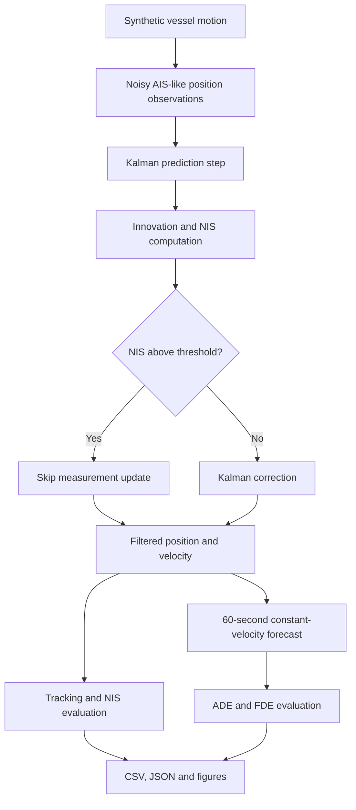

<div align="center">

# 🌊 Maritime AI — Vessel Trajectory Intelligence

### Vessel Tracking · Kalman State Estimation · 60-Second Forecasting · Innovation-Based Screening

**A reproducible Python research prototype for maritime motion estimation and short-horizon trajectory prediction from noisy AIS-like observations.**

    


*Simulated vessel motion, noisy position observations, and the estimated track.*

</div>

> **Project status:** This repository implements a synthetic vessel-motion simulator, a linear Kalman tracking filter, innovation-based measurement screening, and a 60-second constant-velocity forecasting baseline. Results are reproducible for the configuration described below. **No trained neural network, real AIS ingestion, or operational maritime validation is claimed.**

## Contents

- [Overview](#overview)
- [Research objectives](#research-objectives)
- [System architecture](#system-architecture)
- [Mathematical methodology](#mathematical-methodology)
- [Experimental setup](#experimental-setup)
- [Experimental results](#experimental-results)
- [Interpretation and discussion](#interpretation-and-discussion)
- [Installation and reproduction](#installation-and-reproduction)
- [Repository structure](#repository-structure)
- [Limitations and roadmap](#limitations-and-roadmap)
- [Author and license](#author-and-license)

## Overview

Maritime tracking systems receive imperfect position observations. Measurement noise, sporadic corrupted readings, and changes in vessel heading make it difficult to infer a smooth trajectory and predict near-future motion. This project studies a **transparent, interpretable baseline** for those tasks in a controlled simulation.

The workflow generates a maneuvering vessel trajectory in a local East–North coordinate frame, adds Gaussian measurement noise and three deliberate position outliers, estimates vessel position and velocity using a Kalman filter, screens inconsistent measurements using the **normalized innovation squared (NIS)** statistic, and evaluates constant-velocity forecasts against the simulated ground truth.

### Implemented capabilities

| Component | Implementation | Status |
|---|---|---|
| Synthetic vessel trajectories | Smooth speed/heading variations, East–North coordinates | Implemented |
| Noisy observations | Gaussian 2D position noise and injected outliers | Implemented |
| State estimation | 4-state constant-velocity Kalman filter | Implemented |
| Measurement screening | NIS threshold test and skipped inconsistent updates | Implemented |
| Motion forecasting | Constant-velocity prediction up to 60 seconds | Implemented |
| Evaluation | Position RMSE, ADE, FDE, NIS and speed plots | Implemented |
| Real AIS ingestion | AIS decoding, geographic coordinates and cleaning | Planned |
| Deep learning prediction | Trained GRU/LSTM/Transformer | Not implemented |

## Research objectives

1. Recover a stable position and velocity estimate from noisy vessel observations.
2. Assess whether innovation-based screening can reject intentionally corrupted measurements in a controlled scenario.
3. Quantify short-horizon forecasting error using a simple, interpretable baseline.
4. Provide a reproducible foundation for comparing more advanced motion models and learned predictors later.

## System architecture



The screening stage evaluates whether an observation is statistically consistent with the predicted state. A rejected observation is **not proof of malicious activity or abnormal vessel behavior**; it is an outlier relative to the assumed motion and noise models.

## Mathematical methodology

### 1. State representation

The four-dimensional state vector contains planar position and velocity:

$$
\mathbf{x}_k = \begin{bmatrix} E_k & N_k & v_{E,k} & v_{N,k} \end{bmatrix}^{\mathsf T}.
$$

Only position is measured:

$$
\mathbf{z}_k = \mathbf{H}\mathbf{x}_k+\mathbf{v}_k, \qquad
\mathbf{H}=\begin{bmatrix}1&0&0&0\\0&1&0&0\end{bmatrix}.
$$

### 2. Constant-velocity process model

For sample interval $\Delta t=5\ \mathrm{s}$:

$$
\mathbf{x}_{k+1}=\mathbf{F}\mathbf{x}_k+\mathbf{w}_k, \qquad
\mathbf{F}=\begin{bmatrix}
1&0&\Delta t&0\\
0&1&0&\Delta t\\
0&0&1&0\\
0&0&0&1
\end{bmatrix}.
$$

The process covariance is constructed from a discrete acceleration-noise model:

$$
\mathbf{Q}=\sigma_a^2\mathbf{G}\mathbf{G}^{\mathsf T},\qquad
\mathbf{G}=\begin{bmatrix}
\Delta t^2/2&0\\0&\Delta t^2/2\\\Delta t&0\\0&\Delta t
\end{bmatrix}.
$$

The experiment uses $\sigma_a=0.14$ in the implementation's acceleration-noise parameterization and measurement covariance $\mathbf{R}=28^2\mathbf{I}_2\ \mathrm{m}^2$.

### 3. Kalman prediction and correction

**Predict:**

$$
\hat{\mathbf{x}}^-_k=\mathbf{F}\hat{\mathbf{x}}_{k-1},\qquad
\mathbf{P}^-_k=\mathbf{F}\mathbf{P}_{k-1}\mathbf{F}^{\mathsf T}+\mathbf{Q}.
$$

**Innovation and gain:**

$$
\mathbf{y}_k=\mathbf{z}_k-\mathbf{H}\hat{\mathbf{x}}^-_k,\qquad
\mathbf{S}_k=\mathbf{H}\mathbf{P}^-_k\mathbf{H}^{\mathsf T}+\mathbf{R},
$$

$$
\mathbf{K}_k=\mathbf{P}^-_k\mathbf{H}^{\mathsf T}\mathbf{S}_k^{-1}.
$$

**Correct:**

$$
\hat{\mathbf{x}}_k=\hat{\mathbf{x}}^-_k+\mathbf{K}_k\mathbf{y}_k.
$$

The implementation uses the **Joseph-form covariance update** to improve numerical robustness:

$$
\mathbf{P}_k=(\mathbf{I}-\mathbf{K}_k\mathbf{H})\mathbf{P}^-_k
(\mathbf{I}-\mathbf{K}_k\mathbf{H})^{\mathsf T}+\mathbf{K}_k\mathbf{R}\mathbf{K}_k^{\mathsf T}.
$$

### 4. Innovation-based screening

The normalized innovation squared statistic is

$$
\operatorname{NIS}_k=\mathbf{y}_k^{\mathsf T}\mathbf{S}_k^{-1}\mathbf{y}_k.
$$

A measurement update is skipped when $\operatorname{NIS}_k>13.82$ after the initial four samples. This threshold approximates the 99.9th percentile of a chi-square distribution with two degrees of freedom, **assuming the model and noise statistics are correctly specified**. A high NIS indicates measurement-model inconsistency; it does not identify the physical cause.

### 5. Short-horizon prediction

Starting from the filtered state at time $k$, the baseline predicts future position without accessing future measurements:

$$
\hat{\mathbf{p}}_{k+h\mid k}=\hat{\mathbf{p}}_k+h\Delta t\hat{\mathbf{v}}_k,
\qquad h=1,\ldots,12.
$$

Twelve steps at five seconds per step give a **60-second prediction horizon**. This forecast assumes approximately constant velocity and is expected to degrade during heading changes or acceleration.

## Experimental setup

| Setting | Value |
|---|---:|
| Random seed | `42` |
| Samples | `360` |
| Sampling interval | `5 s` |
| Simulated duration | `1,795 s` between first and last sample |
| Coordinate system | Local East–North, metres |
| Measurement noise | Gaussian, `28 m` standard deviation per axis |
| Injected corrupted observations | `3` at sample indices `85`, `185`, `270` |
| Kalman state dimension | `4` |
| NIS gate threshold | `13.82` |
| Forecast horizon | `12 steps / 60 s` |
| Forecast evaluation | Prediction origins from sample `20` onward, where 12 future steps exist |

The simulated trajectory includes gradual heading and speed changes. The estimator uses a simpler constant-velocity assumption, intentionally creating model mismatch during maneuvers. The experiment is deterministic for a given seed, but **a single seed is not a statistical benchmark**.

## Experimental results

### Quantitative summary

| Metric | Result | Interpretation |
|---|---:|---|
| Raw observation position RMSE | **45.86 m** | Error of noisy positions against simulated truth |
| Kalman position RMSE | **21.11 m** | Error of filtered positions against simulated truth |
| Relative RMSE reduction | **53.97%** | Improvement relative to raw-observation RMSE |
| Raw observation RMSE, excluding injected outliers | **38.79 m** | Noise-only comparison on non-outlier samples |
| Kalman RMSE, excluding injected outliers | **20.97 m** | Filtered comparison on the same samples |
| Forecast ADE, 60-second horizon | **44.85 m** | Mean Euclidean forecast error across evaluated steps |
| Forecast FDE, 60-second horizon | **68.47 m** | Mean Euclidean error at the final forecast step |
| Injected corrupted observations | **3** | Deliberately altered position measurements |
| Rejected measurements | **3** | Updates skipped by the NIS gate |
| Automated tests | **3 passed** | Current test suite for the prototype |

**RMSE** is defined for two-dimensional positions as

$$
\mathrm{RMSE}=\sqrt{\frac{1}{N}\sum_{k=1}^{N}\left[(\hat E_k-E_k)^2+(\hat N_k-N_k)^2\right]}.
$$

The reported relative reduction is

$$
100\left(1-\frac{21.1076}{45.8607}\right)\%\approx\mathbf{53.97\%}.
$$

For a forecast origin $k$ and horizon $H=12$, define the displacement error $d_{k,h}=\lVert\hat{\mathbf{p}}_{k+h\mid k}-\mathbf{p}_{k+h}\rVert_2$. **ADE** averages $d_{k,h}$ across all evaluated origins and forecast steps; **FDE** averages $d_{k,H}$ at the 60-second endpoint.

### Figure 1 — Vessel trajectory tracking


*The filtered path is compared with simulated ground truth and noisy position observations. The plot illustrates how sequential estimation can suppress measurement noise while tracking a maneuvering vessel.*

### Figure 2 — Position estimation error


*Time-series position errors reveal both ordinary noise and the effect of injected outliers. The experiment-specific aggregate RMSE values should be interpreted alongside this temporal behavior.*

### Figure 3 — RMSE comparison


*The Kalman estimate achieves 21.11 m RMSE compared with 45.86 m for raw observations, a 53.97% reduction for this simulation.*

### Figure 4 — Innovation-based measurement screening


*The NIS statistic is evaluated against a fixed gate threshold. Three observations are rejected in this run; rejection counts alone do not establish a general anomaly detector's precision or recall.*

### Figure 5 — Vessel speed estimation


*Speed is inferred from the estimated eastward and northward velocity components, rather than supplied as a direct position-filter measurement.*

## Interpretation and discussion

**Noise suppression.** The filtered estimate improves 2D positional accuracy relative to unfiltered observations in the configured scenario. This demonstrates the value of sequential state estimation under the assumed motion and noise models, not a universal 53.97% improvement for maritime tracking.

**Outlier handling.** Innovation gating rejects three inconsistent measurements in this run. Because the dataset contains three deliberately injected outliers, this is an encouraging sanity check, but a broader labeled evaluation would be required to establish detection sensitivity, false-positive rates, and robustness across maneuver types.

**Forecast behavior.** The 60-second endpoint error (FDE) exceeds the average error over the forecast horizon (ADE), consistent with uncertainty and model mismatch accumulating as the prediction extends further into the future. The current predictor has no explicit turn-rate model and no learned maneuver representation.

**Reproducibility.** The published metrics are saved in `results/metrics.json`, with per-sample observations and estimates in `results/synthetic_tracking_results.csv`. The experiment can be rerun with the command below. Results may change with different seeds, trajectories, noise settings, or algorithm parameters.

## Installation and reproduction

**Requirements:** Python 3.10+ and a working Python package installer.

```bash
git clone https://github.com/Mates3834/Maritime-AI-Trajectory-Prediction.git
cd Maritime-AI-Trajectory-Prediction
python -m venv .venv
```

Activate the virtual environment:

```bash
# macOS / Linux
source .venv/bin/activate

# Windows PowerShell
# .venv\Scripts\Activate.ps1
```

Install and execute:

```bash
python -m pip install -e .
python -m pip install pytest
python run_demo.py --seed 42
python -m pytest -q
```

The script writes plots, a metrics JSON file, and a per-sample CSV file to `results/` by default. To choose a different destination:

```bash
python run_demo.py --seed 42 --output custom_results
```

To run the script without installing the package in editable mode, first ensure the `src/` directory is available on your Python import path. The editable installation shown above is the recommended route.

## Repository structure

```text
Maritime-AI-Trajectory-Prediction/
├── README.md
├── LICENSE
├── requirements.txt
├── pyproject.toml
├── run_demo.py
├── 01_trajectory_tracking.png        # README figures at repository root
├── 02_position_error.png
├── 03_rmse_comparison.png
├── 04_innovation_gating.png
├── 05_speed_estimation.png
├── src/
│   └── maritime_ai/
│       ├── __init__.py
│       ├── simulation.py
│       ├── filter.py
│       ├── evaluation.py
│       └── plots.py
├── tests/
│   └── test_pipeline.py
└── results/
    ├── metrics.json
    ├── synthetic_tracking_results.csv
    └── ... generated PNG figures
```

**Image path note:** The five Markdown images in this README use paths such as ``. They must be uploaded **beside `README.md` in the repository root**, not only inside `results/`. The `results/` directory can separately retain the figures generated by the experiment.

## Limitations and roadmap

### Current limitations

- **Synthetic-only data:** No actual AIS messages, vessel identifiers, timestamps from receivers, or geodetic coordinate transformations are processed.
- **Single-vessel simulation:** No multi-vessel association, interactions, or collision-risk assessment.
- **Simplified dynamics:** A constant-velocity filter and forecast cannot explicitly model sustained turns, currents, or complex maneuvers.
- **Limited evaluation:** One default seed and scenario; no multi-seed uncertainty intervals, vessel-level generalization study, or external dataset benchmark.
- **Measurement screening only:** NIS gating flags statistical inconsistency, not confirmed suspicious behavior.
- **Not operational software:** No real-time guarantees, safety certification, or navigational decision support validation.

### Development roadmap

- [x] Synthetic vessel trajectory and noise generation
- [x] Linear Kalman position and velocity estimation
- [x] NIS-based measurement screening
- [x] 60-second constant-velocity forecast baseline
- [x] RMSE, ADE, FDE, CSV/JSON output and five figures
- [x] Automated prototype tests
- [ ] Real AIS dataset ingestion with licensing and quality checks
- [ ] Latitude/longitude to local-coordinate conversion
- [ ] Repeated-seed experiments and confidence intervals
- [ ] Coordinated-turn / IMM / EKF / UKF comparisons
- [ ] GRU/LSTM and other learned forecasting baselines
- [ ] Vessel- and time-separated evaluation to prevent data leakage
- [ ] Multi-vessel encounter analysis and uncertainty-aware forecasts
- [ ] Interactive research dashboard

## Author and license

**Mehmet Ateş** — Electrical & Electronics Engineering; Control and Automation Engineering. Interests include maritime autonomy, robotics, state estimation, and intelligent systems.

GitHub: [@Mates3834](https://github.com/Mates3834)

Distributed under the **MIT License**. See [`LICENSE`](LICENSE).

---

<div align="center"><sub>Research prototype · Synthetic maritime data · Reproducible baseline · Not for operational navigation</sub></div>
