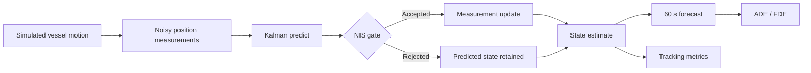
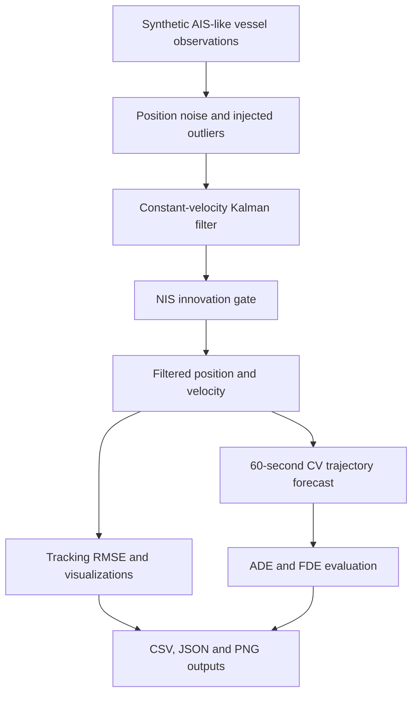

[README-With-Results.md](https://github.com/user-attachments/files/33597767/README-With-Results.md)
<div align="center">

# 🌊 Maritime AI — Vessel Trajectory Intelligence

### Kalman State Estimation · Short-Horizon Forecasting · Maritime Anomaly Screening

**A reproducible Python research prototype for understanding vessel motion from noisy AIS-like observations.**

   


</div>

> **Research status:** The repository includes a working synthetic-data tracking pipeline, a constant-velocity Kalman filter with innovation gating, a 60-second motion forecast baseline, quantitative evaluation, five generated figures and automated tests. It does **not** yet contain trained neural networks or validation on real AIS datasets.

## Overview

Vessel position measurements are noisy, may contain outliers, and do not directly provide reliable velocity estimates. This project demonstrates an end-to-end **estimation and forecasting baseline** that reconstructs a vessel's planar motion from simulated AIS-like position reports, rejects inconsistent measurements, and predicts its near-term path.

**Scope:** single-vessel, local Cartesian coordinates, simulated observations. The project is a reproducible research baseline rather than a production maritime surveillance system.

### At a glance

| Tracking | Forecasting | Quality control | Evaluation |
|:--|:--|:--|:--|
| Linear 4-state Kalman filter | 60-second constant-velocity forecast | NIS-based innovation gate | RMSE, ADE, FDE and 5 figures |

## ✨ Highlights

- **Vessel simulation:** time-stamped synthetic east/north trajectories with smooth heading changes and speed variation.
- **State estimation:** 4-state linear Kalman filter estimates position and planar velocity from noisy observations.
- **Anomaly screening:** normalized innovation squared (NIS) rejects statistically inconsistent position measurements.
- **Trajectory forecasting:** constant-velocity, 60-second forecast using only the filtered state available at prediction time.
- **Reproducibility:** fixed random seed, exported metrics/CSV, generated charts and automated tests.

## System Architecture



## 📊 Experimental Results — Measured Performance

The figures and metrics below were generated by running the included Python experiment, **not** by estimating performance manually. The evaluation uses one reproducible synthetic AIS-like vessel scenario (`seed=42`, 360 samples, 5-second intervals, Gaussian position noise, three injected outliers).

<div align="center">

| Raw measurement RMSE | Filtered position RMSE | RMSE reduction | 60 s forecast FDE |
|:--:|:--:|:--:|:--:|
| **45.86 m** | **21.11 m** | **53.97%** | **68.47 m** |

</div>

### Complete quantitative evaluation

| Metric | Result | Interpretation |
|:--|--:|:--|
| Raw observation position RMSE | **45.86 m** | Error of noisy position reports relative to simulated truth |
| Kalman position RMSE | **21.11 m** | Error of filtered 2D positions relative to simulated truth |
| Relative RMSE reduction | **53.97%** | Improvement over unfiltered measurements in this scenario |
| 60-second forecast ADE | **44.85 m** | Mean forecast displacement error over the forecast horizon |
| 60-second forecast FDE | **68.47 m** | Mean final-point error at 60 seconds |
| Injected measurement outliers | **3** | Deliberately corrupted synthetic observations |
| NIS-gated measurements | **3** | Measurements rejected by the filter's innovation gate |
| Sample count | **360** | One simulated vessel track |
| Sampling interval | **5 s** | Time between consecutive observations |

**RMSE calculation:** $\mathrm{RMSE}=\sqrt{\frac{1}{N}\sum_{k=1}^{N}\|\hat{p}_k-p_k\|_2^2}$. The relative reduction is $(45.86-21.11)/45.86\times100\%$, using full-precision values for the reported **53.97%**. ADE and FDE are computed from forecasts against simulated future positions.

### Figure 1 — Vessel trajectory tracking


The filtered track follows the vessel's underlying trajectory while reducing measurement noise. Turns and speed changes are intentionally included to test a constant-velocity model outside ideal straight-line motion.

### Figure 2 — Position estimation error


This plot compares instantaneous position errors. Individual filtered estimates can still be inaccurate during maneuvers or immediately after measurement disturbances.

### Figure 3 — RMSE comparison


The main tracking result is a reduction from **45.86 m** to **21.11 m**, corresponding to **53.97% lower RMSE** in this experiment.

### Figure 4 — Innovation-based measurement screening


The normalized innovation squared (NIS) is compared against a **13.82** threshold (approximately the 99.9th percentile of a chi-square distribution with two degrees of freedom). The filter gated **3 measurements** in this run; this is not a validated real-world anomaly detection rate.

### Figure 5 — Vessel speed estimation


The filter estimates velocity from noisy position observations. Its constant-velocity assumption limits responsiveness during changes in vessel motion.

### What the results mean

The experiment demonstrates that a conventional state estimator can improve position tracking and support a transparent **60-second forecasting baseline**. It does **not** demonstrate learned AI-based trajectory prediction, real AIS performance, operational collision avoidance, or generalization to different ships and environments. Further evaluation should use multiple seeds, independent trajectories and licensed real AIS datasets.

> **GitHub image layout:** All five PNG files are referenced directly by filename because they are stored in the **same directory as `README.md`**. Do not add `results/` to these image links.

## 🧠 Model and Methods

The filter estimates planar position and velocity in metres and metres per second. The tracked state is

```text
x = [east_position, north_position, east_velocity, north_velocity]^T
```

A constant-velocity state-space model propagates the state and covariance:

```text
x[k+1] = F x[k] + w[k]
z[k]   = H x[k] + v[k]
```

For sample interval $\Delta t$, the constant-velocity transition matrix is

$$
F = \begin{bmatrix}
1 & 0 & \Delta t & 0 \\
0 & 1 & 0 & \Delta t \\
0 & 0 & 1 & 0 \\
0 & 0 & 0 & 1
\end{bmatrix}, \qquad
H = \begin{bmatrix}1&0&0&0\\0&1&0&0\end{bmatrix}.
$$

The filter performs predict/update steps using a Joseph-form covariance update. A 2D normalized innovation squared (NIS) gate (threshold 13.82, approximately the 99.9th percentile of chi-square with 2 degrees of freedom) rejects inconsistent position updates after initialization.

**Forecasting baseline:** Future positions are projected from the filtered position and velocity. This is a physics-inspired **constant-velocity baseline**, not an AI-trained prediction model. It provides a measurable reference for future GRU/LSTM comparisons.

## Processing and Outputs



## Evaluation Protocol

The demonstration generates **360 samples at 5-second intervals** with `seed=42`, applies Gaussian position noise, and injects three position outliers. State estimates are evaluated against the simulator's ground truth. The 60-second forecast is assessed with **average displacement error (ADE)** and **final displacement error (FDE)**.

The filter uses a constant-velocity model even though the synthetic vessel can change course or speed. This deliberate model mismatch helps illustrate the limits of a simple baseline.

## 🚀 Quick Start

**Requirements:** Python 3.10+.

```bash
# Clone your repository
git clone https://github.com/Mates3834/Maritime-AI-Trajectory-Prediction.git
cd Maritime-AI-Trajectory-Prediction

# Create an isolated environment
python -m venv .venv
# Linux / macOS:
source .venv/bin/activate
# Windows PowerShell:
# .venv\Scripts\Activate.ps1

# Install the project and testing tools
pip install -e .
pip install pytest

# Run the reproducible experiment
python run_demo.py --seed 42

# Run tests
pytest -q
```

The script regenerates figures inside `results/` (copy updated PNGs into the repository root to refresh README images) and `results/metrics.json` and exports per-sample estimates to `results/synthetic_tracking_results.csv`.

## 📂 Repository Structure

```text
Maritime-AI-Trajectory-Prediction/
├── README.md
├── 01_trajectory_tracking.png
├── 02_position_error.png
├── 03_rmse_comparison.png
├── 04_innovation_gating.png
├── 05_speed_estimation.png
├── LICENSE
├── requirements.txt
├── pyproject.toml
├── run_demo.py
├── src/
│   └── maritime_ai/
│       ├── __init__.py
│       ├── simulation.py
│       ├── filter.py
│       ├── evaluation.py
│       └── plots.py
├── tests/
│   └── test_pipeline.py
└── results/
    ├── metrics.json
    └── synthetic_tracking_results.csv
```

## Research Extensions

Potential next steps include benchmarking across many random seeds and maneuver types, geodetic AIS preprocessing, vessel-wise train/test separation, nonlinear filters, and learned sequence models. These are **proposed extensions**, not implemented features.

## 🗺️ Roadmap

- [x] Reproducible synthetic maritime trajectory generator
- [x] Kalman position and velocity estimation
- [x] Innovation-based outlier screening
- [x] 60-second constant-velocity prediction baseline
- [x] Quantitative RMSE / ADE / FDE evaluation
- [x] Five generated experiment figures
- [x] Automated regression tests
- [ ] Licensed, real-world AIS ingestion and geodetic coordinate conversion
- [ ] Train/test split by vessel and time to avoid data leakage
- [ ] GRU/LSTM models and robust multi-horizon benchmarks
- [ ] Nonlinear motion model / EKF or UKF comparison
- [ ] Multi-vessel encounters and risk indicators
- [ ] Interactive vessel-traffic dashboard

## ⚠️ Limitations

This experiment uses **synthetic local-coordinate data**, not raw AIS messages. Injected position outliers are illustrative and do not represent validated detection of suspicious vessel behavior. Reported accuracy is specific to the configured scenario and should not be extrapolated to real operations. This software is not suitable for operational navigation, collision avoidance or safety-critical maritime decisions.

## 👨‍💻 Author

**Mehmet Ateş**  
Electrical & Electronics Engineering · Control and Automation Engineering  
Interests: maritime autonomy, robotics, estimation, control and intelligent systems  
[GitHub profile](https://github.com/Mates3834)

## 📄 License

MIT License — see [LICENSE](LICENSE).
