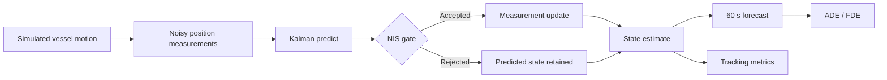
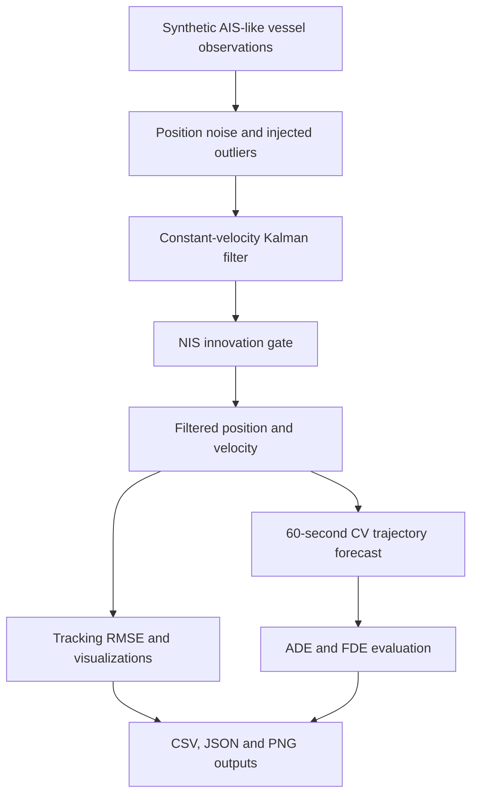

<div align="center">
🌊 Maritime AI — Vessel Trajectory Intelligence
Kalman State Estimation · Short-Horizon Forecasting · Maritime Anomaly Screening
A reproducible Python research prototype for understanding vessel motion from noisy AIS-like observations.
   

</div>
> **Research status:** The repository includes a working synthetic-data tracking pipeline, a constant-velocity Kalman filter with innovation gating, a 60-second motion forecast baseline, quantitative evaluation, five generated figures and automated tests. It does **not** yet contain trained neural networks or validation on real AIS datasets.
Overview
Vessel position measurements are noisy, may contain outliers, and do not directly provide reliable velocity estimates. This project demonstrates an end-to-end estimation and forecasting baseline that reconstructs a vessel's planar motion from simulated AIS-like position reports, rejects inconsistent measurements, and predicts its near-term path.
Scope: single-vessel, local Cartesian coordinates, simulated observations. The project is a reproducible research baseline rather than a production maritime surveillance system.
At a glance
Tracking	Forecasting	Quality control	Evaluation
Linear 4-state Kalman filter	60-second constant-velocity forecast	NIS-based innovation gate	RMSE, ADE, FDE and 5 figures
✨ Highlights
Vessel simulation: time-stamped synthetic east/north trajectories with smooth heading changes and speed variation.
State estimation: 4-state linear Kalman filter estimates position and planar velocity from noisy observations.
Anomaly screening: normalized innovation squared (NIS) rejects statistically inconsistent position measurements.
Trajectory forecasting: constant-velocity, 60-second forecast using only the filtered state available at prediction time.
Reproducibility: fixed random seed, exported metrics/CSV, generated charts and automated tests.
System Architecture

📊 Experimental Results
Results below come from the included synthetic scenario (`seed=42`, 360 samples, 5-second sampling, Gaussian position noise and three injected position outliers).
Metric	Measured result
Noisy observation position RMSE	45.86 m
Kalman estimate position RMSE	21.11 m
RMSE reduction	53.97%
60-second forecast ADE	44.85 m
60-second forecast FDE	68.47 m
Injected position outliers	3
Measurements rejected by NIS gate	3
Metric definitions: Position RMSE is the square root of mean squared 2D Euclidean position error. ADE averages displacement errors across all evaluated forecast steps; FDE averages errors at the 60-second endpoint. Gated observations are not treated as confirmed real-world anomalies.
Figure 1 — Vessel trajectory and tracking
The main figure above compares the simulated ground-truth path, noisy observations, and filtered position estimates.
Figure 2 — Position error over time

Figure 3 — RMSE comparison

Figure 4 — Innovation-based outlier screening

Figure 5 — Estimated vessel speed

> All five PNG images are stored **next to `README.md` in the repository root**. GitHub renders them directly using same-folder relative paths.
Interpreting the results
The Kalman filter reduces position RMSE from 45.86 m to 21.11 m in this seeded experiment, a 53.97% reduction relative to the raw observations.
The 60-second forecast has an ADE of 44.85 m and an FDE of 68.47 m; these are baseline errors, not operational accuracy guarantees.
All 3 injected outliers were gated in this experiment. This does not establish a real-world anomaly detection rate or false-alarm rate.
Results depend on the simulated motion, measurement noise, gate threshold and random seed. A multi-seed evaluation and independent real AIS testing are future work.
🧠 Model and Methods
The filter estimates planar position and velocity in metres and metres per second. The tracked state is
```text
x = [east_position, north_position, east_velocity, north_velocity]^T
```
A constant-velocity state-space model propagates the state and covariance:
```text
x[k+1] = F x[k] + w[k]
z[k]   = H x[k] + v[k]
```
For sample interval $\Delta t$, the constant-velocity transition matrix is
$$
F = \begin{bmatrix}
1 & 0 & \Delta t & 0 \
0 & 1 & 0 & \Delta t \
0 & 0 & 1 & 0 \
0 & 0 & 0 & 1
\end{bmatrix}, \qquad
H = \begin{bmatrix}1&0&0&0\0&1&0&0\end{bmatrix}.
$$
The filter performs predict/update steps using a Joseph-form covariance update. A 2D normalized innovation squared (NIS) gate (threshold 13.82, approximately the 99.9th percentile of chi-square with 2 degrees of freedom) rejects inconsistent position updates after initialization.
Forecasting baseline: Future positions are projected from the filtered position and velocity. This is a physics-inspired constant-velocity baseline, not an AI-trained prediction model. It provides a measurable reference for future GRU/LSTM comparisons.
Processing and Outputs

Evaluation Protocol
The demonstration generates 360 samples at 5-second intervals with `seed=42`, applies Gaussian position noise, and injects three position outliers. State estimates are evaluated against the simulator's ground truth. The 60-second forecast is assessed with average displacement error (ADE) and final displacement error (FDE).
The filter uses a constant-velocity model even though the synthetic vessel can change course or speed. This deliberate model mismatch helps illustrate the limits of a simple baseline.
🚀 Quick Start
Requirements: Python 3.10+.
```bash
# Clone your repository
git clone https://github.com/Mates3834/Maritime-AI-Trajectory-Prediction.git
cd Maritime-AI-Trajectory-Prediction

# Create an isolated environment
python -m venv .venv
# Linux / macOS:
source .venv/bin/activate
# Windows PowerShell:
# .venv\Scripts\Activate.ps1

# Install the project and testing tools
pip install -e .
pip install pytest

# Run the reproducible experiment
python run_demo.py --seed 42

# Run tests
pytest -q
```
The script regenerates figures inside `results/` (copy updated PNGs into the repository root to refresh README images) and `results/metrics.json` and exports per-sample estimates to `results/synthetic_tracking_results.csv`.
📂 Repository Structure
```text
Maritime-AI-Trajectory-Prediction/
├── README.md
├── 01_trajectory_tracking.png
├── 02_position_error.png
├── 03_rmse_comparison.png
├── 04_innovation_gating.png
├── 05_speed_estimation.png
├── LICENSE
├── requirements.txt
├── pyproject.toml
├── run_demo.py
├── src/
│   └── maritime_ai/
│       ├── __init__.py
│       ├── simulation.py
│       ├── filter.py
│       ├── evaluation.py
│       └── plots.py
├── tests/
│   └── test_pipeline.py
└── results/
    ├── metrics.json
    └── synthetic_tracking_results.csv
```
Research Extensions
Potential next steps include benchmarking across many random seeds and maneuver types, geodetic AIS preprocessing, vessel-wise train/test separation, nonlinear filters, and learned sequence models. These are proposed extensions, not implemented features.
🗺️ Roadmap
[x] Reproducible synthetic maritime trajectory generator
[x] Kalman position and velocity estimation
[x] Innovation-based outlier screening
[x] 60-second constant-velocity prediction baseline
[x] Quantitative RMSE / ADE / FDE evaluation
[x] Five generated experiment figures
[x] Automated regression tests
[ ] Licensed, real-world AIS ingestion and geodetic coordinate conversion
[ ] Train/test split by vessel and time to avoid data leakage
[ ] GRU/LSTM models and robust multi-horizon benchmarks
[ ] Nonlinear motion model / EKF or UKF comparison
[ ] Multi-vessel encounters and risk indicators
[ ] Interactive vessel-traffic dashboard
⚠️ Limitations
This experiment uses synthetic local-coordinate data, not raw AIS messages. Injected position outliers are illustrative and do not represent validated detection of suspicious vessel behavior. Reported accuracy is specific to the configured scenario and should not be extrapolated to real operations. This software is not suitable for operational navigation, collision avoidance or safety-critical maritime decisions.
👨‍💻 Author
Mehmet Ateş  
Electrical & Electronics Engineering · Control and Automation Engineering  
Interests: maritime autonomy, robotics, estimation, control and intelligent systems  
GitHub profile
📄 License
MIT License — see LICENSE.
